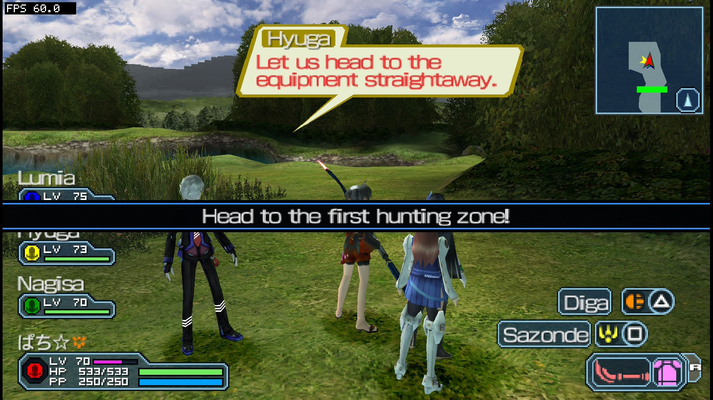

# Phantasy Star Portable 2 Infinity (Switch 2 Port)



Phantasy Star Portable 2 Infinity running natively on Switch 2 under [kaiHEN](https://github.com/ouncebrew/kaihen).
Based on [PSP2I_Recomp](https://github.com/zmbkilla/PSP2I_Recomp), a static recompilation of the game.

**Status: beta (v0.9.1).** Offline play only.

## Features and fixes

- **60 fps** throughout, from the game's own 30 fps. **120 fps is experimental.**
- Dodge rolls fixed at 60 fps (no jump forward at the start of a roll).
- Up to **4x internal resolution** (drawn at 1920x1088 and fitted to the 1080p screen), with crisp or smooth scaling and optional FXAA.
- Anisotropic filtering, mipmaps (no shimmering textures in the distance) and a longer draw distance.
- **Custom texture packs** (PPSSPP format), loaded at start-up so they never pop in or stutter.
- The ISO is loaded into memory at start-up, so loading never waits on the SD card.
- An in-game settings menu (R3), saved between sessions.

## You must supply your own game

This download contains **no game data**. You need your own copy of:

- **Phantasy Star Portable 2 Infinity with the English fan translation patch (v2) applied**, as an `.iso` file

To make it from your own Japanese copy of the game, follow the community guide:
**[psp2i.wiki: Installation, English patch](https://psp2i.wiki/w/Installation#English_patch)**

The original, unpatched Japanese ISO is **not supported**: the port is built for the English-patched game's
code, and shows an error if you give it the unpatched ISO. Do not ask for the ISO here.

You also need the PSP's system fonts (`flash0:/font`) from your own PSP or from PPSSPP.

## Install

1. Download `psp2i.nro` from the [Releases](../../releases) page and copy it to `sdmc:/switch/` on your SD card.
2. Create the folder `sdmc:/psp2i/`.
3. Copy your English-patched ISO into it, and the PSP fonts into `sdmc:/psp2i/GameData/flash/font/`, so you have:

   ```
   sdmc:/
   ├── switch/
   │   └── psp2i.nro
   └── psp2i/
       ├── Phantasy Star Portable 2 Infinity (English v2).iso
       └── GameData/
           └── flash/
               └── font/
                   └── (the PSP's .pgf font files)
   ```

4. Start it from the homebrew menu.

Each launch loads the ISO into memory first (a loading bar, about 2 seconds), so the game never waits on the
SD card while you play.

## Saves

Saves go to `sdmc:/psp2i/GameData/ms/PSP/SAVEDATA/`, in the PSP's own format.

To bring over a save from PPSSPP, copy its `NPJH50332` folders (`NPJH50332`, `NPJH50332SC`, `NPJH50332DL`) from
PPSSPP's `PSP/SAVEDATA/` into that folder.
The save must be **unencrypted**: in PPSSPP, set `EncryptSave = False` in `ppsspp.ini` and save once in the game
before copying.

## Controls

- **R3** (press the right stick): open and close the settings menu.
- **Right stick**: camera.
- **+ and - together**: quit to the homebrew menu.

## Settings

Open the menu with **R3**. Changes are saved to `sdmc:/psp2i/psp2i.ini` as you make them.

| Setting | Default | Meaning |
|---|---|---|
| Frame rate | 60 FPS | `60` runs the game at 60 fps. `30` is the PSP's own rate. `120` is **experimental**. |
| FPS counter | Off | Shows the frame rate in the corner. |
| Internal resolution | 4x | `4x` is drawn at 1920x1088 and fitted to the 1080p screen, and holds 60 fps. `1x` to `3x` also work. |
| Draw distance | Far | Draws distant scenery further away than on the PSP. `Normal` is the PSP's own distance; `Max` brings in every object and can drop below 60 fps. |
| Fog | Off | The game's distance fog. |
| Anisotropic | 4x | Sharper textures on floors and walls seen at an angle. |
| Mipmaps | On | Stops distant textures from shimmering. |
| Custom textures | Off | Loads texture packs from `sdmc:/psp2i/textures/` (see below). |
| Scaling | Nearest | How the picture is scaled to the screen: `Nearest` keeps it crisp, `Bilinear` smooths it. FXAA can be added. |

The menu also has volume (master, music, effects), right-stick camera speed and swapping Circle and Cross.

## Custom textures

The port loads PPSSPP-format texture packs: a folder with a `textures.ini` and its PNG files, the kind made for
PPSSPP's `PSP/TEXTURES/NPJH50332` folder. No pack is included; download them from their authors.

1. Put the pack in its own folder in `sdmc:/psp2i/textures/`, for example `sdmc:/psp2i/textures/PSPo2i HD/`.
2. Turn **Custom textures** on in the menu, then restart the port.

The whole pack is loaded behind a second loading bar when the port starts, so textures never pop in or stutter
during play.

- The first start with a new or changed pack decodes every picture and takes a while (about 15 seconds for a
  2,000-picture pack). It also saves them to `sdmc:/psp2i/textures/cache.bin` (around 600 MB for such a pack).
- Later starts read that file instead and take a second or two.
- If you replace a picture in a pack without changing its `textures.ini`, delete `cache.bin` so it is made again.

## Known issues

- Distant scenery, such as rows of trees on far hills, can flicker as the camera moves.
- The intro movie's sound can be choppy.
- No online play or ad hoc multiplayer.

## Reporting a problem

Open an issue on this GitHub repository and attach `psp2i_log.txt` from `sdmc:/psp2i/logs/`. It is written every
launch. Say which version you ran (shown in the homebrew menu) and what you were doing: area, mission, menu.

## Credits and license

- [PSP2I_Recomp](https://github.com/zmbkilla/PSP2I_Recomp) and [psprecomp](https://github.com/zmbkilla/psprecomp) by zmbkilla (psprecomp is MIT-licensed, originally by sp00nznet)
- The PSP2i community for the English translation patch, research and texture packs
- [kaiHEN](https://github.com/ouncebrew/kaihen), libounce and OunceVK by the ouncebrew contributors
- [OpenH264](https://github.com/cisco/openh264) for movies, Mesa, libnx

The port's source changes are in [`patches/`](patches): one for PSP2I_Recomp and one for psprecomp.

Phantasy Star Portable 2 Infinity is the property of SEGA. This project is not affiliated with SEGA.

## How this port was made

Most of the Switch 2 port's code was written by Claude, Anthropic's AI model.
